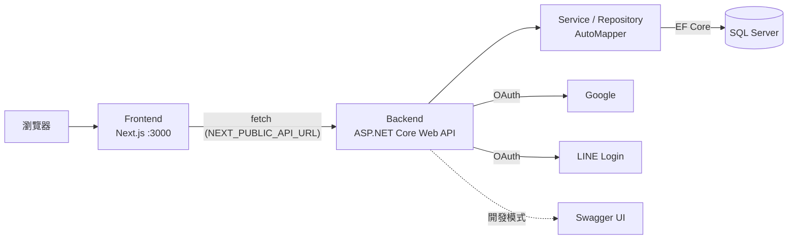

<div align="center">

# Authora

**前後端分離的會員系統：帳密註冊登入、Google / LINE 第三方登入**


</div>

---

## 📖 簡介

Authora 是一個練習用的帳號系統專案：前端用 Next.js 做註冊 / 登入 / 重設密碼頁面，後端用 ASP.NET Core Web API（Controller → Service → Repository 分層，AutoMapper 轉 DTO）搭配 Entity Framework Core 存取 SQL Server，支援 Google 與 LINE 第三方登入，並附 Swagger 文件方便測試 API。

## ✨ 功能特色

- 📝 **註冊**：檢查帳號是否已被使用，建立新使用者
- 🔐 **登入**：比對帳號密碼並回傳結果
- 🟢 **Google 登入**：ASP.NET Core Google Authentication + Cookie
- 💬 **LINE 登入**：LINE Login OAuth 流程與 ID Token 解析
- 👤 **使用者管理**：查詢、刪除使用者
- 🔁 **重設密碼**頁面（開發中）
- 📘 **Swagger UI**：開發模式下自動產生 API 文件（含 XML 註解）

## 🏗️ 系統架構



## 🧰 技術棧

| 層 | 技術 |
| --- | --- |
| 前端 | Next.js 16、React 19、TypeScript、Tailwind CSS 4、shadcn/ui、Base UI、axios |
| 後端 | .NET 8、ASP.NET Core Web API、AutoMapper、Swashbuckle（Swagger） |
| 認證 | Cookie Authentication、Google Authentication、LINE Login |
| ORM / 資料庫 | Entity Framework Core 8、SQL Server |

## 📂 專案結構

```text
Authora/
├── Frontend/              # Next.js 前端
│   ├── app/
│   │   ├── login/           # 登入頁
│   │   ├── register/        # 註冊頁
│   │   └── resetPassword/   # 重設密碼頁
│   ├── hook/useAuth.ts      # 登入 / 註冊狀態
│   └── lib/api.ts           # API client
├── Backend/
│   └── Backend/           # ASP.NET Core Web API
│       ├── Controllers/     # Login、User、Auth（Google）、Line
│       ├── Services/        # 商業邏輯
│       ├── Repositories/    # 資料存取
│       ├── Mappings/        # AutoMapper 設定
│       ├── Models/          # Entities、Dtos、Params
│       └── Program.cs
└── packages/              # 共用 auth / ui 套件（規劃中）
```

## 🔌 API

| 方法 | 路徑 | 說明 |
| --- | --- | --- |
| `POST` | `/api/Register` | 註冊新帳號，帳號重複時回 400 |
| `POST` | `/api/Login` | 登入，帳號或密碼錯誤時回 400 |
| `GET` | `/api/User/{acc}` | 查詢使用者 |
| `DELETE` | `/api/User/{acc}` | 刪除使用者 |
| `GET` | `/api/google` → `/api/google-callback` | Google 登入 |
| `GET` | `/api/line` → `/api/line-callback` | LINE 登入 |

## 🚀 快速開始

### 後端

```bash
cd Backend/Backend
dotnet run
```

在 `appsettings.Development.json`（或 User Secrets）設定連線字串 `ConnectionStrings:DefaultDBConnection`。開發模式下可到 `/swagger` 測試 API。

### 前端

```bash
cd Frontend
pnpm install
pnpm dev     # http://localhost:3000
```

## ⚙️ 環境變數

| 位置 | 變數 | 說明 |
| --- | --- | --- |
| `Frontend/.env.local` | `NEXT_PUBLIC_API_URL` | 後端 API 網址 |
| 後端設定 | `ConnectionStrings:DefaultDBConnection` | SQL Server 連線字串 |
| 後端設定 | `Authentication:Google:ClientId` / `ClientSecret` | Google 登入（callback：`/signin-google`） |
| 後端設定 | `LineLogin:ChannelId`、`LineLogin:RedirectUri` 等 | LINE 登入 |

> 後端 CORS 目前只允許 `http://localhost:3000`。

## 🗺️ 待辦

- [ ] 密碼雜湊（目前以明碼比對）
- [ ] 帳密登入的 Session / JWT（目前只有第三方登入用 Cookie）
- [ ] 重設密碼流程
